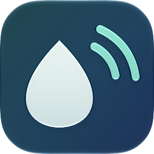
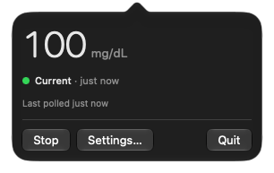

  

<h1 align="center">CGM Relay</h1>

  <b>A Mac menu bar app that keeps every minute of your Libre glucose, even while your phone sleeps.</b>

  
  
  
  
  

  <a href="https://github.com/yaanfpv/cgm-relay/releases/latest"><b>Download for Mac</b></a> · <a href="#connect-your-app">Connect your app</a> · <a href="docs/TECHNICAL.md">How it works</a>

Your phone lets xDrip run for a moment, then puts it back to sleep, and the minutes in between are gone. LibreLinkUp only keeps a point every 15 minutes. So you wake up to a graph full of holes.

CGM Relay fixes that from your Mac. It follows your LibreLinkUp account every single minute, keeps every reading, and hands them all to xDrip4iOS, xDrip+, LoopFollow, Nightguard or any Nightscout follower app the moment it wakes up. No gaps, no account, no cloud in between.

  

## Get started in two minutes

1. [Download CGM Relay](https://github.com/yaanfpv/cgm-relay/releases/latest), open the disk image and drag it to Applications.
2. Open it and follow setup. It signs you in to LibreLinkUp, sets up how your phone reaches your Mac (one click if you use Tailscale) and connects your app with a QR code.
3. Turn off your app's own LibreLinkUp follower. Only one thing should follow your account.

That's it. Your app now gets every minute.

## What you get

- **Every minute, kept.** Readings are encrypted on your Mac and kept for 15 days, or as long as you like.
- **A menu bar icon that stays out of your way.** It turns amber when readings are late and red when something stops, and can show your number right there.
- **Set and forget.** It can open at login, and it recovers by itself after a LibreLinkUp outage or rate limit.
- **Private.** Your follower apps talk to your Mac, not to us. There's no account and nothing to sign up for.
- **Free and open source.** Read every line, build it yourself, or run it on a Linux server instead.

## Connect your app

Setup shows a QR code for each of these. To set one up by hand:

**xDrip4iOS.** In Settings, set **Master or Follower** to **Follower** and **Data Source** to **Nightscout**. Under **Sharing and Services**, open **Nightscout**, put the relay's address in **URL** and your access token in **Token**. If the address has a port, like `:1337`, put that in **Port** and leave it out of **URL**. Leave **API_SECRET** blank.

**xDrip+ (Android).** In Settings, choose **Nightscout Follower** as the data source and set **Nightscout Follow URL** to `https://YOUR-TOKEN@your-relay-address`.

**LoopFollow.** In Settings, open **Nightscout** and fill in **URL** and **Token**.

**Nightguard.** Put the address in **Nightscout URL**, with no slash at the end, and the token in **API Token**.

## Supported

- macOS 15 Sequoia or later, Apple silicon and Intel.
- FreeStyle Libre sensors that share through LibreLinkUp.
- xDrip4iOS, xDrip+, LoopFollow, Nightguard, and anything that reads a Nightscout site.
- Linux, if you'd rather [run it on a server](docs/TECHNICAL.md#run-it-on-a-server).

## Privacy

CGM Relay collects nothing. It talks to LibreLinkUp with your own account, and to GitHub once a day to check for updates, which you can turn off in Settings > Updates. Report a Bug opens a prefilled GitHub issue, and nothing is sent until you submit it.

## Good to know

- **CGM Relay is not a medical device.** Readings and alerts can be late, missing or wrong. Don't make treatment decisions from it, and keep the official Libre app and its alarms on for lows. It isn't made by or affiliated with Abbott, and it comes with no warranty.
- LibreLinkUp has no official API. CGM Relay uses the same endpoints the LibreLinkUp app and other open-source followers use, and those can change.
- It only sees what LibreLinkUp has. If the phone running LibreLink drops off, those minutes come back later as 15-minute history.
- It needs a Mac that stays awake, or a small server.

## Contributing

Found a bug or want something? Use Report a Bug in the app (right-click the menu bar icon) or [open an issue](https://github.com/yaanfpv/cgm-relay/issues/new). [CONTRIBUTING.md](CONTRIBUTING.md) covers building and testing, and [SECURITY.md](SECURITY.md) covers reporting a vulnerability.

If CGM Relay fills your gaps, give it a star. It helps other Libre users find it.

## License

[GNU AGPL-3.0](LICENSE). If you want to build it into a closed product, [open an issue](https://github.com/yaanfpv/cgm-relay/issues/new) and ask about a commercial license.

Built by [@YaanFPV](https://github.com/YaanFPV).
