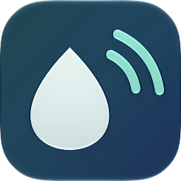
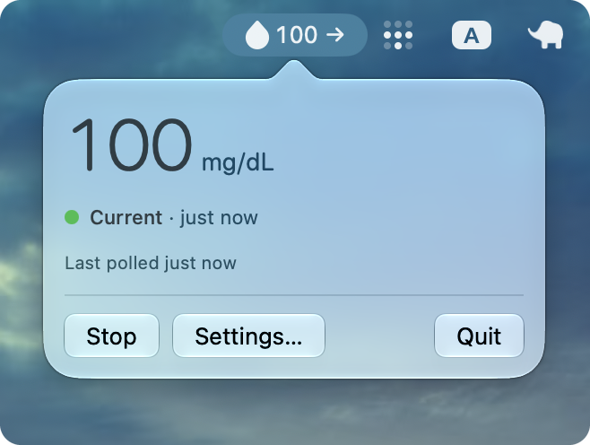

  

<h1 align="center">CGM Relay</h1>

  <b>A Mac menu bar app that checks LibreLinkUp about once a minute and stores every reading it gets, encrypted, so your loved ones can follow along and your AI agents can analyze them.</b>

  
  
  
  
  

  <a href="https://github.com/yaanfpv/cgm-relay/releases/latest"><b>Download for Mac</b></a> · <a href="#connect-your-app">Connect your app</a> · <a href="docs/TECHNICAL.md">How it works</a>

You follow a child's, partner's or parent's FreeStyle Libre. Your phone puts the follower app to sleep whenever you are not using it, and when it wakes, LibreLinkUp has only a reading every 15 minutes for the time it missed. The graph is full of holes.

CGM Relay keeps the readings on a Mac instead of your phone and serves them to xDrip4iOS, xDrip+, LoopFollow, Nightguard, Sweet Dreams, Zukka or any app that follows a Nightscout site. Everyone following sees the same record, wherever they are.

  <picture>
    <source media="(prefers-color-scheme: dark)" srcset="docs/images/panel-dark.png">
    
  </picture>

## Get started

1. [Download CGM Relay](https://github.com/yaanfpv/cgm-relay/releases/latest), open the disk image and drag it to Applications.
2. Open it and follow setup. You sign in to LibreLinkUp, choose how your phone reaches your Mac, choose whether to keep the Mac awake and connect your app with a QR code.
3. Turn off your app's own LibreLinkUp follower. Only one thing should follow the account.

Your app now catches up whenever it wakes.

## What it asks of your Mac

- **Keep awake, if you turn it on.** On a laptop, CGM Relay asks for your password to set up its permission to change the sleep setting. macOS also asks you to allow its background item, which then appears under System Settings > General > Login Items & Extensions. That item lets the Mac sleep again if the app ever stops unexpectedly. A desktop Mac needs neither.
- **A Tailscale sign-in, if you pick the built-in route.** The app opens a sign-in window. A free Tailscale account works.
- **A check for updates once a day.** It goes to GitHub, and you can turn it off in Settings > Updates. A downloaded update installs the next time CGM Relay quits, or when you choose Restart to Update.

The Mac has to stay on for CGM Relay to keep reaching LibreLinkUp.

## What you get

- **Your minutes, kept.** Readings are encrypted on your Mac and kept for 30 days. You can set anything from 1 to 90.
- **A menu bar icon that stays out of your way.** It turns amber when readings are late and red when something stops, and it shows the number unless you turn that off.
- **Set and forget.** It can open at login, and it recovers by itself after a LibreLinkUp outage or rate limit.
- **A Mac that stays awake.** Stays awake while plugged in, even with the lid closed. On battery it sleeps as usual. On a laptop it asks for your password to set this up.
- **Yours to analyze.** The record answers the same Nightscout requests a follower app makes, so an AI agent or a script can read it with your token.
- **Free and open source.** Read every line, build it yourself, or run it on a Linux server.

## Reach your Mac from your phone

Setup asks how your phone should get to your Mac. Settings lets you change it later.

- **Your own Tailscale.** If Tailscale is on your Mac, your Mac gets a private https address on your tailnet, turned on with one click. Your phone needs Tailscale too.
- **The Tailscale built into CGM Relay.** Your Mac gets a public https address and your phone needs nothing installed. Apps that fetch from their own servers, such as Sweet Dreams, need this one.
- **This Mac only.** Only apps on this Mac connect. It is the default, and Settings offers it.

On the built-in route, no account or server of ours is involved. Tailscale's relay carries the traffic and cannot read it. Your token is still needed to read your data.

## Connect your app

Setup shows a QR code for each of these. To set one up by hand:

**xDrip4iOS.** In Settings, set **Master or Follower** to **Follower** and **Data Source** to **Nightscout**. Under **Sharing and Services**, open **Nightscout**, put the relay's address in **URL** and your access token in **Token**. If the address has a port, like `:1337`, put that in **Port** and leave it out of **URL**. Leave **API_SECRET** blank.

**xDrip+ (Android).** In Settings, set **Hardware Data Source** to **Nightscout Follower** and **Nightscout Follow URL** to `https://YOUR-TOKEN@your-relay-address`.

**LoopFollow.** In Settings, open **Nightscout** and fill in **URL** and **Access Token**.

**Nightguard.** Put the address in **Nightscout URL**, with no slash at the end, and the token in **API Token**.

**Sweet Dreams.** Use the built-in Tailscale address. Open **Link Your Nightscout**, then **Nightscout Details**, put the address in the first field and the token in the second, and tap **Login**.

**Zukka.** The steps are the same as xDrip4iOS.

## Supported

- macOS 15 Sequoia or later, Apple silicon and Intel.
- FreeStyle Libre sensors that share through LibreLinkUp.
- xDrip4iOS, xDrip+, LoopFollow, Nightguard, Sweet Dreams, Zukka, and anything that reads a Nightscout site.
- Linux, if you would rather [run it on a server](docs/TECHNICAL.md#run-it-on-a-server).

## Privacy

CGM Relay has no account and collects nothing. It talks to LibreLinkUp with your own account and to GitHub once a day to check for updates. On the built-in route it also talks to Tailscale, to sign in and publish your address.

That address's name, made of the name Tailscale gives CGM Relay's node and your tailnet's DNS name, appears in public certificate logs, as the name of any https site does. No reading or token does. Report a Bug opens a GitHub issue in your browser with this app's version and build, your macOS version and your chip filled in. The issue is created only when you submit it.

## Good to know

- **CGM Relay is not a medical device.** Readings and alerts can be late, missing or wrong. Do not make treatment decisions from it, and keep the official Libre app and its alarms on for lows. It is not made by or affiliated with Abbott, and it comes with no warranty.
- LibreLinkUp has no official API. CGM Relay uses the same endpoints the LibreLinkUp app and other open-source followers use, and those can change.
- If you wear the sensor and your phone runs LibreLink, xDrip4iOS and Zukka can follow LibreLinkUp on that same phone, using the sensor's Bluetooth as a heartbeat to stay awake. CGM Relay is still worth having if you want your readings kept encrypted on your Mac, where your own tools and AI agents can read them.
- It only sees what LibreLinkUp has. If the phone running LibreLink drops off, those minutes come back later as 15-minute history. A reading LibreLinkUp replaces quickly can also slip between two checks.
- On battery a Mac sleeps as usual. The minute readings from that time are lost, and the 15-minute history is kept.

## Remove it

If you use the built-in route, switch to another way in Settings first, so the Mac logs out of Tailscale. If the logout cannot reach Tailscale, for example while you are offline, Settings says the Mac is not yet logged out, and the app tries again each time it opens. Wait until that notice is gone, then quit CGM Relay and delete the app. If you delete it sooner, the Mac can stay listed in your Tailscale account until you remove it in the admin console. On a laptop, keeping the Mac awake leaves a few things behind, and [the technical notes](docs/TECHNICAL.md#what-keep-awake-leaves-on-your-mac) list them with the commands to remove them.

## Roadmap

- **Windows.** The same relay, living in the system tray by the clock instead of the menu bar.
- **A Docker image and a systemd unit,** so a server install is one command.
- **More CGM clouds** after LibreLinkUp.

No dates. If one of these matters to you, [open an issue](https://github.com/yaanfpv/cgm-relay/issues/new) and say so.

## Contributing

Found a bug or want something? Use Report a Bug in the app (right-click the menu bar icon) or [open an issue](https://github.com/yaanfpv/cgm-relay/issues/new). [CONTRIBUTING.md](CONTRIBUTING.md) covers building and testing, and [SECURITY.md](SECURITY.md) covers reporting a vulnerability.

## License

[GNU AGPL-3.0](LICENSE). If you want to build it into a closed product, [open an issue](https://github.com/yaanfpv/cgm-relay/issues/new) and ask about a commercial license.

Built by [@YaanFPV](https://github.com/YaanFPV).
